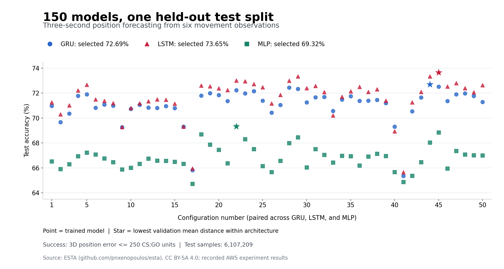

# Tracking AI

**Three-second player position forecasting from short movement histories.**


A supervised learning project for developing a tracking component for horror-game enemies. Given six past observations of a player's position and walking state, the model estimates the player's position approximately three seconds after the final observation.

The current implementation is an **offline forecasting benchmark**. Future integration will combine perceived sound locations, model predictions, and game search logic so a creature can follow incomplete evidence and respond to player misdirection.

## At a glance

| Item | Current implementation |
| --- | --- |
| Input | Six observations of `x`, `y`, `z`, and `isWalking` |
| Output | Three coordinates, represented as displacement from the last observed position |
| Models | GRU, LSTM, and MLP |
| Experiments | 50 paired configurations per architecture; 150 models total |
| Training samples | 27,990,778 |
| Held-out test samples | 6,107,209 |
| Best recorded accuracy | **73.65%**, LSTM configuration 45 |
| Training hardware | AWS EC2 `g5.xlarge`, NVIDIA A10G 24 GB, Ubuntu, 200 GB storage |

## Results

The table reports one model per architecture selected by **lowest validation mean 3D distance error**. Test accuracy was not the model-selection criterion.

| Architecture | Selected model | Test accuracy | Hidden size | Layers | Batch size |
| --- | --- | ---: | ---: | ---: | ---: |
| GRU | `gru_44` | 72.69% | 192 | 3 | 4096 |
| **LSTM** | **`lstm_45`** | **73.65%** | **256** | **3** | **4096** |
| MLP | `mlp_22` | 69.32% | 128 | 3 | 4096 |

The selected LSTM made **4,497,928 successful predictions out of 6,107,209 test samples**. All three selected models use learning rate `0.001` and weight decay `0`; GRU/LSTM use dropout `0.2`, while the selected MLP uses `0`.



*Each point is one trained model. The same configuration number uses the same six hyperparameter values across architectures. Stars indicate validation-selected models. Source: [ESTA](https://github.com/pnxenopoulos/esta); measured results: [comparison.csv](results/sweep_150/comparison.csv).*

Accuracy is a **distance-threshold success rate**, not exact coordinate matching:

```text
successful prediction = Euclidean 3D distance(predicted position, true position) <= 250
accuracy (%)          = successful predictions / test samples * 100
```

The threshold is expressed in CS:GO coordinate units. Earlier results on the same test split were 69.68% for the original GRU and 70.22% for the pilot LSTM. Historical last-position and Kalman baselines scored 52.32% and 49.13%. Full settings, counts, and comparison limits are documented in [the experiment notes](docs/EXPERIMENTS.md).

## Dataset and preprocessing

The project uses **Esports Trajectories and Actions (ESTA)**, a public CS:GO dataset provided by Xenopoulos et al. Its upstream repository contains 1,558 compressed match recordings, stored as `.json.xz` files. Each match contains metadata, rounds, frames, teams, and player records. Frames are sampled at approximately 2 Hz. See the [dataset repository](https://github.com/pnxenopoulos/esta) and [dataset paper](https://arxiv.org/abs/2209.09861).

```text
match -> gameRounds -> frames -> t/ct -> players
                                      x, y, z, isWalking
```

1. Split match files into approximately **70% training / 15% validation / 15% test**, using seed 42.
2. Connect alive-player records within each round using `steamID`, ordered by server tick.
3. Require continuous ticks across the complete observation-to-target window. Reject missing coordinates, non-finite values, and input intervals with negligible movement.
4. Use records **1-6 as input** and record **12 as the target** for the usual 64-tick sampling interval and 127/128 Hz tick rate. Records 7-11 establish continuity and are not model inputs.
5. Subtract the last observed position from input coordinates and the target. Normalize coordinates with a scale computed from training inputs only.

At a 128 Hz server tick rate, consecutive stored frames are 64 ticks apart, or 0.5 seconds. Six recorded observations span **2.5 seconds from first to last**; the target is **3 seconds after the last observation**. At 127 Hz, these intervals are slightly longer. Timing is derived from each file's tick rate and parser sampling interval.

Historical coordinates currently act as **simulated localized footstep observations**. This project does not yet localize real audio. `isWalking=False` after movement filtering is a simplified running proxy. Velocity columns are excluded. See [the data notes](docs/DATA.md) for all available columns and limitations.

## Getting started

The original training entry points require a CUDA-capable GPU. The sweep caches prepared arrays in GPU memory; the recorded full run used an A10G with 24 GB VRAM. A small CPU check is available without downloading ESTA.

```bash
git clone https://github.com/nohseongmin/tracking-ai.git
cd tracking-ai
python -m venv .venv
source .venv/bin/activate
python -m pip install -r requirements.txt
python -m unittest discover -s tests -v
```

The pinned dependencies match the publication-time local smoke-check environment. For GPU training, use a compatible CUDA-enabled PyTorch installation; consult the [official installation guide](https://pytorch.org/get-started/locally/).

### 1. Obtain and inspect ESTA

Download the approximately 3.9 GB dataset directly from its original source. Reading already-parsed JSON uses Python's built-in `lzma` module and does not require Awpy.

```bash
git clone --depth 1 https://github.com/pnxenopoulos/esta.git data/esta
python scripts/audit_dataset.py data/esta --output runs/raw_dataset_audit.json
```

### 2. Prepare samples and train the original GRU

This historical entry point performs both preprocessing and baseline GRU training. Use a fresh output directory; it produces shards, the split manifest, training history, and a checkpoint containing the normalization scale.

```bash
python scripts/train_three_second_gru.py \
  --dataset data/esta/data \
  --output runs/baseline \
  --prediction-seconds 3 \
  --epochs 10
```

### 3. Run the published 150-model sweep

```bash
mkdir -p runs
nohup python -u scripts/run_sweep_150.py \
  --prepared-run runs/baseline \
  --output runs/sweep_150 \
  --experiments configs/sweep_150.json \
  --epochs 100 \
  --patience 3 \
  --radius 250 > runs/sweep_150.log 2>&1 &

tail -F runs/sweep_150.log
```

`100` is the maximum epoch count. Early stopping remains enabled when validation mean distance fails to improve for three consecutive epochs. Training uses **Adam and MSE loss**. The runner writes progress, checkpoints, per-model results, a comparison CSV, and the validation-based selection. Completed models are reused when the same sweep command is rerun.

### 4. Inspect published results and export charts

Results are included as small CSV/JSON reports; raw data, prepared shards, and trained checkpoints are kept outside Git.

```bash
python -m pip install -r requirements-viz.txt
python analysis/export_ppt_graphs.py \
  --csv results/sweep_150/comparison.csv \
  --export results/sweep_150/export.json \
  --planned configs/sweep_150.json \
  --output runs/ppt_graphs
```

This exports seven white-background, 3200 x 1800 PNG charts. The original presentation labels are in Korean.

To regenerate the English overview in this README:

```bash
python analysis/plot_overview.py \
  --csv results/sweep_150/comparison.csv \
  --export results/sweep_150/export.json \
  --planned configs/sweep_150.json \
  --output runs/accuracy_overview.png
```

## Repository structure

```text
scripts/     Actual preprocessing, training, attribute, and evaluation scripts
configs/     Frozen configurations for the 150-model experiment
results/     Published aggregate results and experiment metadata
analysis/    Result validation and chart exporters
assets/      README result figure
docs/        Data schema, experiment details, and licensing notes
tests/       CPU checks for models, continuity, alignment, and recorded results
```

## Scope and next steps

The sweep uses a baseline-centered set of configurations, so **hyperparameter values have unequal experiment counts**. A dense cluster of points does not establish that its parameter value is best. Individual parameter effects require comparisons with the remaining settings held fixed. The paired architecture comparison also does not equalize model parameter counts.

The reported accuracy applies to the retained movement windows, which exclude input intervals containing near-stationary movement. One random seed was used. Real audio uncertainty, unseen-map generalization, search behavior, and Unity integration have not been evaluated.

- [x] Audit ESTA and prepare continuous movement windows
- [x] Establish GRU and classical baselines
- [x] Evaluate extra posture attributes as an offline diagnostic
- [x] Complete 50 paired GRU/LSTM/MLP settings and publish results
- [ ] Analyze errors and oversample difficult **training** examples
- [ ] Repeat selected experiments with additional random seeds
- [ ] Evaluate map constraints and adaptation to the game's movement system
- [ ] Export a selected model and integrate it into Unity creature search logic

## References and license

- **Dataset:** Xenopoulos et al., [ESTA repository](https://github.com/pnxenopoulos/esta) and [paper](https://arxiv.org/abs/2209.09861).
- **README organization references:** [Social-STGCNN](https://github.com/abduallahmohamed/Social-STGCNN) and [Trajectron++](https://github.com/StanfordASL/Trajectron-plus-plus). Their dataset/setup/evaluation documentation informed this README's organization; their model implementations and benchmark claims are not used here.
- **Framework:** [PyTorch](https://pytorch.org/).

Original code and authored documentation are available under the **[MIT License](LICENSE)**. ESTA remains **CC BY-SA 4.0**. The reports under `results/` and the figure under `assets/` are released under **CC BY-SA 4.0** with dataset attribution. See [DATA_LICENSE.md](DATA_LICENSE.md). No affiliation with or endorsement by the dataset or reference-project authors is implied.
